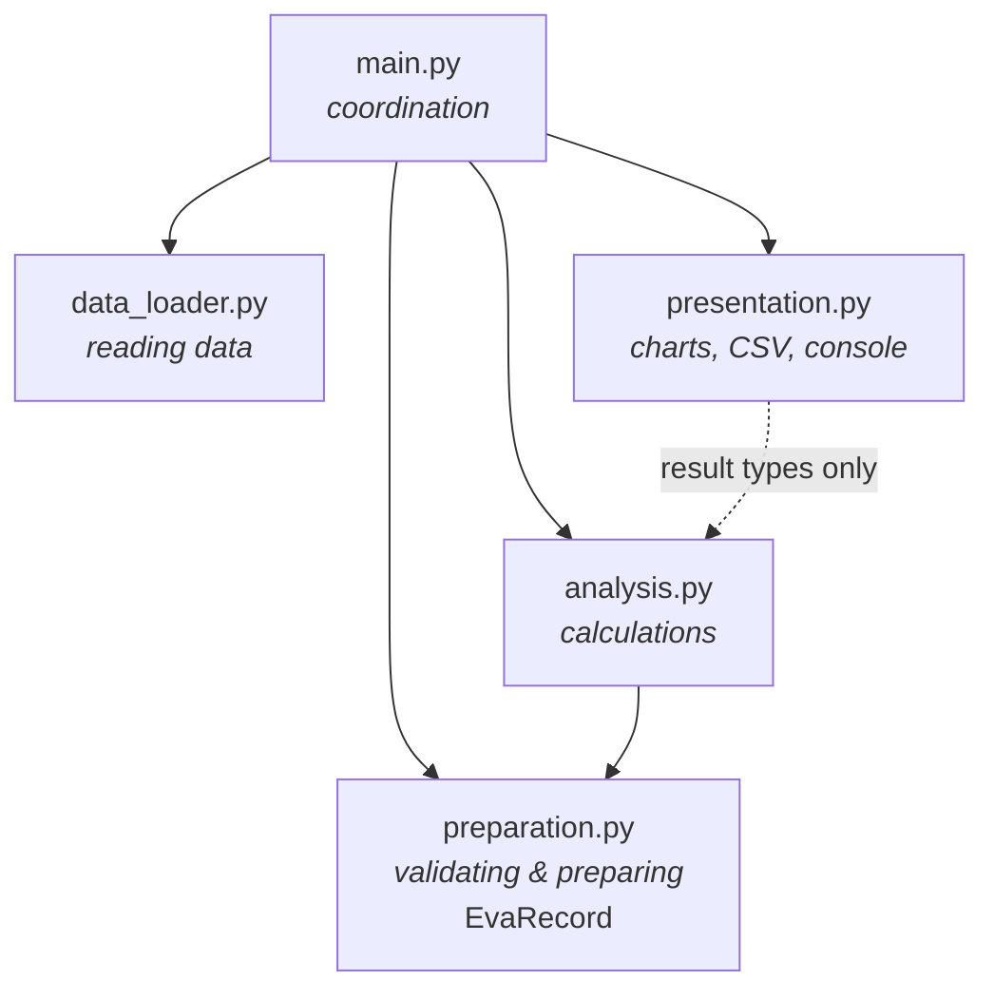

# Architecture

This document records the architectural assessment of the inherited EVA
processor, the structure it was moved to, and an evaluation of the result.
Individual decisions are recorded as ADRs in [`docs/adr/`](adr/).

## 1. Initial architectural assessment (inherited code)

### What the application does

The inherited repository (8 commits, all by the previous developer) contains a
single script, `src/data_handler.py` (84 lines). Running it:

1. Reads `data/eva-data.json` (375 EVA records, countries `USA` and `Russia`).
2. Parses each record's `date` (ISO 8601) and `duration` (`"H:MM"`).
3. **Cumulative duration report** — sorts dated EVAs chronologically, computes
   the running total of hours, plots it and saves
   `outputs/cumulative_duration.png`.
4. **Duration per country report** — totals hours per country, prints them,
   plots a bar chart (`outputs/duration_per_country.png`) and writes
   `outputs/duration_per_country.csv`.

Baseline output recorded before any change:

```
  Russia: 626.58
  USA: 1360.07
```

Data quirks the code relies on implicitly:

- 44 EVAs have a duration but no date. They are **included** in the per-country
  totals but **excluded** from the cumulative chart.
- 1 EVA has no duration and is excluded from both.

### Existing modules and their responsibilities

| Unit | Responsibilities |
|------|------------------|
| `src/data_handler.py` (module level) | Path configuration, creating the output directory, reading JSON, parsing dates and durations, sorting, cumulative calculation, plotting, coordinating the run |
| `load_json()` | Reading JSON |
| `get_eva_duration_per_country()` | Parsing durations **and** aggregating per country |
| `plot_country_totals()` | Bar chart presentation |
| `save_country_totals_to_csv()` | CSV presentation |

There is one module. Every responsibility listed in AR1 (reading, validating
and preparing, analysis, presentation, coordination) lives in it.

### Areas where responsibilities are mixed

- **Lines 29–51**: one block of top-level code parses records, sorts, computes
  the cumulative total and plots it. The cumulative analysis has no name and
  can't be reused.
- **`get_eva_duration_per_country()`** parses raw duration strings itself, so
  the analysis is mixed with data preparation.
- **Lines 80–84**: printing, plotting and CSV writing are interleaved with the
  calculation call.

### Dependencies / coupling

- **Analysis is coupled to the raw JSON format.** Both calculations read the
  dictionary keys `"date"`, `"duration"` and `"country"` and parse the
  `"H:MM"` text themselves. If the data format changes, every calculation has
  to change too.
- **Duplicated parsing logic.** The duration parsing
  (`map(int, duration_text.split(":"))`) is written twice (lines 35 and 60).
  The two copies can drift apart.
- **Calculation is coupled to display.** The cumulative calculation writes into
  module-level lists (`dates`, `cumulative_hours`, `total_hours`) that only
  exist to be passed to `plt.plot`.
- **Global state.** `records`, `dates`, `cumulative_hours`, `total_hours` and
  `eva_data` are module globals.

### Functionality that is difficult to test independently

All work happens at import time. `import data_handler` creates
`outputs/`, reads the real data file, writes two PNGs and a CSV, and calls
`plt.show()`, which blocks. So it isn't possible to:

- test the cumulative calculation (it isn't a function);
- test per-country totals without real-format raw dictionaries;
- test anything without matplotlib installed and a display available.

Malformed input (e.g. a duration of `"abc"`) raises an uncaught exception that
terminates the program.

## 2. Proposed architecture

The application is split into a layered pipeline. Each module owns exactly one
AR1 responsibility and depends only on the layers beneath it. The rationale is
in [ADR-001](adr/ADR-001-layered-module-structure.md).



| Module | Responsibility | Public interface |
|--------|----------------|------------------|
| `data_loader` | Read the EVA data source; knows about JSON and files, nothing else | `load_eva_data(path) -> list[dict]` |
| `preparation` | Validate raw records and convert them to a typed domain record; the only module that knows the raw field names and the `"H:MM"` format | `EvaRecord`, `parse_duration(text)`, `prepare_records(raw) -> list[EvaRecord]` |
| `analysis` | Pure calculations over `EvaRecord`s; no I/O | `cumulative_duration(records)`, `duration_per_country(records)` |
| `presentation` | Turn results into charts, CSV files and console text; the only module that imports matplotlib | `plot_cumulative_duration`, `plot_country_totals`, `save_country_totals_csv`, `print_country_totals`, `show_charts` |
| `main` | Configuration (paths), command-line handling, calling the other modules in order | `main(argv)` |

**Interfaces between layers**

- `data_loader → main`: a plain `list[dict]`, exactly as in the file.
- `preparation → analysis`: a `list[EvaRecord]`, where
  `EvaRecord(country, date | None, duration_hours)`. Analysis never sees raw
  strings.
- `analysis → presentation`: plain Python values (lists, dicts, dataclasses).
  Presentation never sees file formats, and analysis never imports a plotting
  library.

Dependency rules: no module depends on `main`; `analysis` doesn't depend on
`data_loader` or `presentation`; `presentation` doesn't depend on
`data_loader` or `preparation`.
